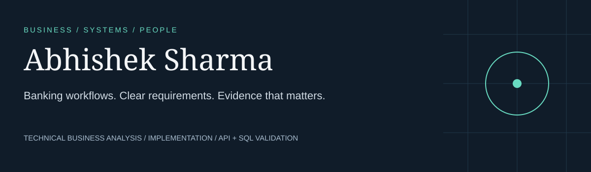

<a href="https://whynotabhi.netlify.app/"><strong>Visit my portfolio ↗</strong></a> · <a href="#try-the-projects">Try my projects ↓</a>

I'm building towards **Business Analyst and banking implementation roles**, with prior exposure to FIS Digital One and a focus on clear requirements, data validation and UAT.

## Try the projects

### 01 / Payment Review Desk
**Which payments need attention, and why?**

Upload a synthetic CSV, inspect duplicate candidates, record review decisions and export the results. Includes interactive charts and 11 automated business-rule checks.

[**Open live app ↗**](https://abhisheksharma0605.github.io/payment-review-desk/) · [Code and case study](https://github.com/abhisheksharma0605/payment-review-desk)

### 02 / Change Request Studio
**Every requirement has a test. Does that mean we're ready?**

A BA workspace connecting scope, Given/When/Then requirements, UAT evidence and readiness. Includes a traceability view, report export and 9 automated checks.

[**Open live app ↗**](https://abhisheksharma0605.github.io/change-request-studio/) · [Code and case study](https://github.com/abhisheksharma0605/change-request-studio)

## What the projects demonstrate

| Business analysis activity | Working evidence |
|---|---|
| Define expected behavior | Explicit rules and acceptance criteria |
| Check data quality | CSV validation and edge-case tests |
| Investigate exceptions | Review reasons, decisions and notes |
| Connect requirements to testing | UAT traceability and recorded evidence |
| Communicate a decision | Charts, CSV exports and BA reports |

[Personal portfolio ↗](https://whynotabhi.netlify.app/)

Personal projects developed with AI coding assistance and synthetic data. These are independent prototypes, not FIS deliverables or client engagements. Sample outcomes do not represent measured business impact.
