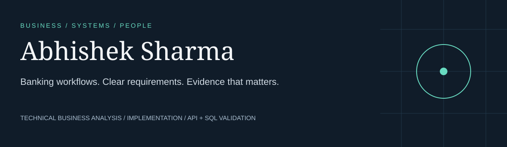

<a href="https://whynotabhi.netlify.app/"><strong>Visit my portfolio ↗</strong></a>
&nbsp; · &nbsp; <a href="#selected-projects">Explore the work ↓</a>

I’m building towards **banking Business Analyst and implementation roles**, bringing prior exposure
to FIS Digital One and focused practice in requirements, UAT, SQL and API validation.

My focus: understanding a workflow, making the rules clear, and checking that the system behaves as intended.

## Selected projects

### 01 / Banking payment validation

**What happens when a customer retries the same payment?**

A working transfer simulation with duplicate prevention, negative API tests, SQL ledger
reconciliation and acceptance criteria. Built independently with synthetic data.

[Explore the project →](https://github.com/abhisheksharma0605/banking-payment-validation)
· [Read the case study](https://github.com/abhisheksharma0605/banking-payment-validation/blob/main/docs/case-study.md)
· [Inspect test evidence](https://github.com/abhisheksharma0605/banking-payment-validation/blob/main/evidence/results.md)

### 02 / Banking onboarding: requirements to release

**The migration passes its checks. Is the business ready to go live?**

A BA case study connecting process maps, requirements, mapping, SQL checks, UAT traceability
and a release recommendation. Includes a Power BI build exercise with reconciliation targets.

[Explore the project →](https://github.com/abhisheksharma0605/bank-onboarding-ba-case-study)
· [Follow the requirements](https://github.com/abhisheksharma0605/bank-onboarding-ba-case-study/blob/main/docs/requirements.md)
· [See the release decision](https://github.com/abhisheksharma0605/bank-onboarding-ba-case-study/blob/main/docs/release-decision.md)

## How the work connects

| Business question | Evidence | Decision |
|---|---|---|
| What should happen? | Requirements and acceptance criteria | Agree expected behaviour |
| Did it happen correctly? | API responses, SQL checks and UAT cases | Investigate mismatches |
| Are we ready to release? | Reconciliation, defects and acceptance gates | Make an explicit recommendation |

## Beyond the repositories

[**whynotabhi.netlify.app ↗**](https://whynotabhi.netlify.app/) — my personal portfolio, bringing together
my professional interests and creative identity, created with AI assistance.

These are independent, AI-assisted practice projects with synthetic data, not FIS deliverables
or client engagements. Each distinguishes executed technical checks from personal practice and
business sign-off. Power BI Desktop validation is pending.
